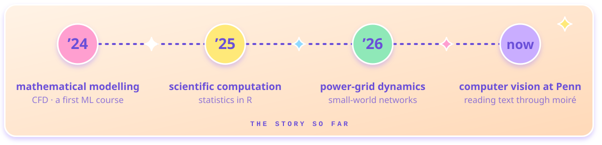

  

### 👋 About me

I'm a graduate student at the University of Pennsylvania, working on **computer vision**. I like problems where a tidy model runs into messy, real-world data.

- 🔭 **Now:** building ReadScreen, a system that makes phone photos of screens readable again.
- 📚 **Studying:** computer vision, artificial intelligence and big data analytics.
- 🎯 **Looking for:** research and internship opportunities in AI and robotics.
- 🌈 **Fun fact:** I will always pick the colourful colormap.

### 🔬 Projects

<table>
<tr>
<td width="50%" valign="top">

**ReadScreen** · course project, team

Photograph a screen with a phone and the pixel grid interferes with the camera sensor, leaving moiré stripes that destroy small text. We restore the photo under one rule: the text must **read** correctly, judged by OCR against ground truth rather than by image quality scores.

`PyTorch` `OpenCV` `ESDNet` `DBNet` `Tesseract`
</td>
<td width="50%" valign="top">

**Grid stability** · research code

When does a power grid fall out of step as renewables come in? Swing-equation models on small-world networks: bifurcations, critical coupling and cascading failures, starting from a reproduction of Smith et al., *Science Advances* (2022).

`NumPy` `SciPy` `NetworkX` `pandas`
</td>
</tr>
</table>

### 🧰 Tools

  

Also: NumPy · SciPy · pandas · NetworkX · Jupyter

### 🗺️ Path so far

