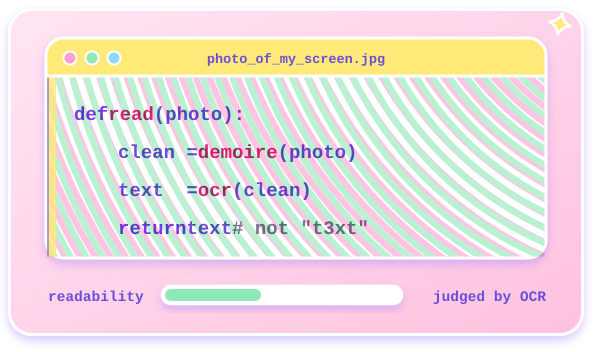
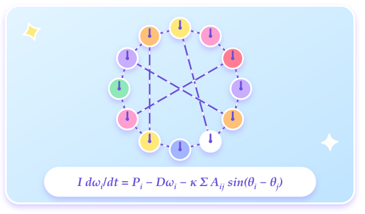
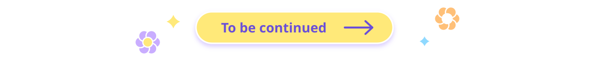

  

### 👋 About me

I'm Yiwen (Charlotte), an MSE student in Scientific Computing at the University of Pennsylvania, with a background in mathematics and applied mathematics. I'm interested in **computer vision**, **machine learning** and **robotics**.

- 🔭 **Now:** building ReadScreen, a system that makes phone photos of screens readable again.
- 📚 **Studying:** computer vision, artificial intelligence and big data analytics.
- 🎯 **Looking for:** research and internship opportunities in AI and robotics.
- 🌈 **Fun fact:** I will always pick the colourful colormap.

### 🔬 Projects

<table>
<tr>
<td width="50%" valign="top">

**ReadScreen** · *in progress* · team course project

**Goal:** make phone photos of screens readable again. Success means the text reads correctly under OCR, not a better image-quality score.

**Method:** classical filtering, fine-tuned demoiréing networks, and a vote between OCR readings that picks the best restoration for each photo.

`PyTorch` `OpenCV` `ESDNet` `DBNet` `Tesseract`
</td>
<td width="50%" valign="top">

**Grid stability** · research code

**Goal:** find when a power grid falls out of step as renewable generation grows.

**Method:** swing-equation simulations on small-world networks, covering bifurcations, critical coupling and cascading failures. It starts from a reproduction of Smith et al., *Science Advances* (2022).

`NumPy` `SciPy` `NetworkX` `pandas`
</td>
</tr>
</table>

### 🧰 Tools

  

Also: NumPy · SciPy · pandas · NetworkX · Jupyter

### 🗺️ Path so far

